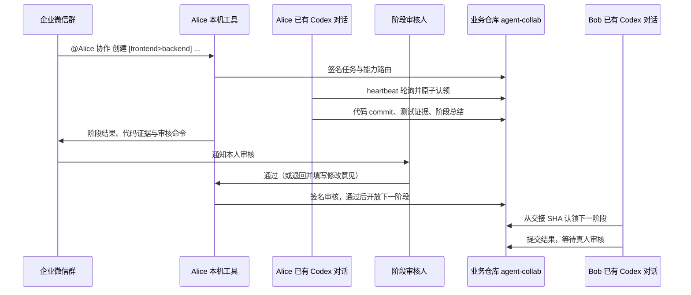

# Codex Collab

把企业微信群的任务交给指定的已有 Codex 对话：管理员统一创建并分配机器人，同事导入个人接入包、绑定对话，即可接单、提交结果、通知真人审核并接力。每位成员只运行本机工具；共享任务协议和交接记录保存在业务仓库的 `agent-collab` 分支。

## 安装与入口

需要 Node.js 20+、Git、Codex 桌面应用，以及业务仓库的读取和 push 权限。先 clone 业务仓库；成员无需 clone 本工具源码。

```sh
npm install --global xuym-codex-collab
codex-collab setup
```

`setup` 打开本机网页工作台，所有接入操作集中在一个页面。管理员选择“初始化团队”，成员选择“加入团队”；已在使用旧配置的成员选择“导入已有配置”。终端保持运行即可继续使用工作台，关闭工作台后已启动的机器人连接仍运行。

| 谁 | 在工作台做什么 | 接入后需要保留什么 |
| --- | --- | --- |
| 管理员 | 初始化业务仓库；在群里验证自己；分配各成员机器人与职责；下载加密接入包；确认成员申请；按职责设置真人审核规则 | 本机身份、管理员配置和机器人连接 |
| 成员 | 导入个人接入包与密码；选择自己的业务仓库 clone；在群里发送验证码；等待管理员确认；复制启用指令到选定 Codex 对话 | 本机机器人连接，以及该对话的轮询自动化 |

管理员先在企业微信创建**独立智能机器人**并加入协作群，再填写 Bot ID/Secret。工具通过群验证码发现群 `chatid` 和真人 `userid`，不需要成员手工寻找这些 ID、生成密钥或编辑 JSON。机器人 Secret 通过加密接入包交给指定成员，密码单独传递。

同一个真人可以拥有多个 Agent，每个 Agent 使用独立机器人、签名身份、业务 clone 和 Codex 对话。管理员在项目页点击“给自己增加机器人”，验证同一个企业微信账号后自动接入，无需下载包或填写包密码；给同事分配时仍使用加密接入包，同事可以领取多份。相同 userid 不会合并 Agent 权限，审核通知会指明应使用的机器人。

完整步骤与旧配置迁移见 [团队接入指南](docs/onboarding.md)。

## 一次任务如何接力



例如在群里选中实际 Alice 机器人发送：

```text
@Alice 协作 创建 [frontend>backend] 给登录页增加密码显示切换 | npm test 通过
```

Alice 的绑定对话轮询到任务后在隔离 worktree 执行前端阶段，提交代码、运行固定验证命令、写入总结；群里收到分支、提交 SHA、测试结果和审核命令。默认由实际执行者本人审核，通过后才开放 Bob 的后端阶段。退回时必须填写修改意见，当前阶段从被退回的提交继续修改，重新提交后再次审核。管理员可在工作台按职责选择审核人、额外通知对象，或关闭中间阶段审核。候补从 Git 签名事件和租约判断，机器人 @ 消息本身不负责调度。群消息中的验收文字不会替换管理员设置的本机测试 argv。

代码保存在独立 `codex/*` 分支；任务和签名策略保存在 `agent-collab`，两者不自动合并到 `main`。最后阶段始终等待真人审核，审核通过后由管理员完成任务。

审核人在群里 @ 自己绑定的机器人，复制最新通知中的任务 ID 和 `R-版本号`：

```text
协作 审核 T-实际任务ID R-7 通过
协作 审核 T-实际任务ID R-7 退回 | 请补充键盘操作和相关测试
```

每次重新提交都产生新的版本号，旧审核命令不能批准新结果。只有指定审核人能审核；通知对象不因此获得审核权限。没有本人群身份的旧测试机器人仍由管理员审核。同一真人的新 Agent 分别验证后可各自处理审核，按通知指定的机器人操作。

群通知会列出审核人与通知对象，并尝试用已验证的 `userid` 生成提及。**智能机器人长连接中的原生 @ 提醒仍需实群验证**；不能把收到结果通知等同于已触发原生 @。部分机器人得到的是加密 userid，本工具尚未集成企业应用的明文 ID 转换。群里的人需要先加入同一协作群，并完成自己的接入验证。

共享 owner 的策略与本人邀请需要所有参与者使用支持此功能的新工具，并重启 Runner/MCP；旧安装不支持这些记录。

## 状态与数据

工作台分别检查项目 MCP/Skill 配置、企微认证、目标对话绑定和实际轮询。机器人认证成功只能说明连接可用；还需要对话真实轮询才能执行任务。MCP 本身不能唤醒闲置对话，“启用指令”会要求在**当前选定对话**建立 heartbeat，应用需支持并运行该自动化。

成员私钥在成员本机生成。Git 记录公钥、成员职责、签名邀请/申请、任务事件、代码引用、测试和阶段总结；Secret、对话 ID、运行令牌及聊天全文留在本机。团队新增成员或修改审核规则后会发布新的签名策略版本；旧任务继续遵循创建时的策略，避免改写已运行任务的权限和候补。

停止工作台或机器人连接不会自动暂停 Codex heartbeat；需要暂停协作时，应在对应对话暂停自动化，并检查在执行任务的状态。

## 开发与兼容

```sh
pnpm install --frozen-lockfile
npm test
node bin/codex-collab.mjs setup
```

保留 `codex-collab setup --terminal`、`setup --role admin|member` 和原有 `start` / `stop` / `status` 等命令。终端模式沿用旧 `team.json` 工作流，网页向导使用签名团队版本与加密个人接入包，初始化 v3 人工审核策略。旧 v2 团队导入后仍保留原行为；保存审核规则才升级，升级前请先更新所有成员的工具并重启机器人和 MCP。不会改写全局 Codex、CC Switch 或模型账号设置。

- [接入、迁移和首次验收](docs/onboarding.md)
- [团队签名协议与目录](docs/team-registry.md)
- [Peer 机制与底层命令](docs/peer.md)
- [已有桌面对话轮询机制](docs/desktop-poll.md)
- [旧中心服务与飞书接入](docs/legacy-center.md)

2026-10-10 已由用户验证本机真实企业微信群 + Alice/Bob 两个已有 Codex 对话的接力闭环。网页向导与真人审核闭环通过临时 Git 仓库、模拟机器人和实际浏览器操作验证；2026-10-12 这轮测试没有连接真实机器人，原生 @ 尚未验证。跨两台机器的部署尚未验证。
