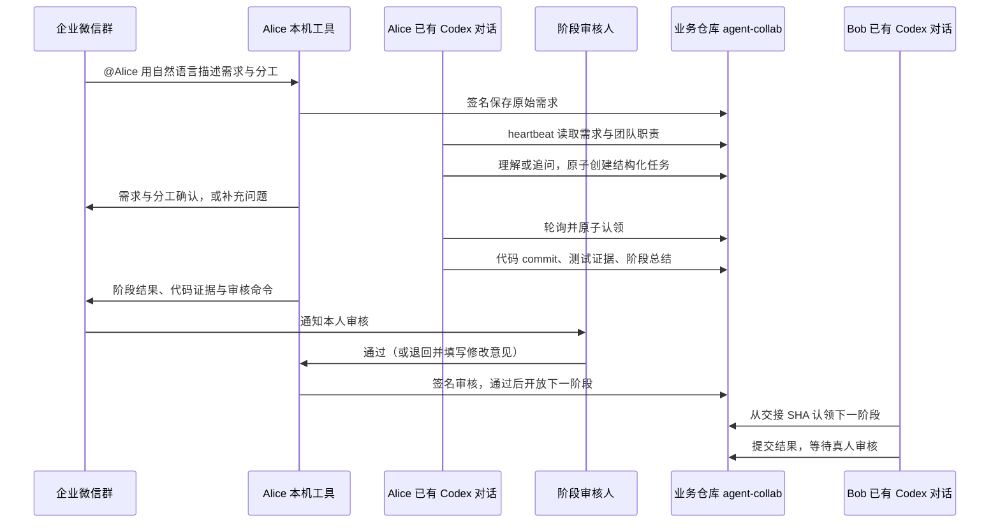

# Codex Collab

把企业微信群的任务交给指定的已有 Codex 对话：管理员统一创建并分配机器人，同事导入个人接入包、绑定对话，即可接单、提交结果、通知真人审核并接力。每位成员只运行本机工具；共享任务协议和交接记录保存在业务仓库的 `agent-collab` 分支。

## 安装与入口

需要 Node.js 20+、Git、Codex 桌面应用，以及业务仓库的读取和 push 权限。业务仓库需已有 `main` 分支；可以使用独立的本机 clone，也可以让向导拉取新目录。成员无需 clone 本工具源码。

```sh
npm install --global xuym-codex-collab
codex-collab setup
```

`setup` 打开本机网页工作台，所有接入操作集中在一个页面。管理员选择“初始化团队”，成员选择“加入团队”；群身份验证、等待审批和本机配置会自动衔接，页面显示当前进度。已在使用旧配置的成员选择“导入已有配置”。终端保持运行即可继续使用工作台，关闭工作台后已启动的机器人连接仍运行。

| 谁 | 在工作台做什么 | 接入后需要保留什么 |
| --- | --- | --- |
| 管理员 | 选择或拉取项目，确认推荐的验证命令；在群里验证自己；批量分配机器人与职责；下载加密接入包并复制接入说明；确认自动出现的成员申请 | 本机身份、管理员配置和机器人连接 |
| 成员 | 导入接入包与密码，使用已有 clone 或让向导拉取；在群里发送验证码；审批通过后自动配置；将一条启用指令发送到选定 Codex 对话 | 本机机器人连接，以及该对话的轮询自动化 |

管理员先在企业微信创建**独立智能机器人**并加入协作群，再填写 Bot ID/Secret。工具通过群验证码发现群 `chatid` 和真人 `userid`，不需要成员手工寻找这些 ID、生成密钥或编辑 JSON。机器人 Secret 通过加密接入包交给指定成员；批量分配自动生成密码，可在“已分配的机器人”查看并单独复制。接入说明不含密码和 Secret。显示名称支持中文，职责可从前端、后端、全栈、测试等预设中选择；内部 ID 和自定义标签放在高级选项中。

同一个真人可以拥有多个 Agent，每个 Agent 使用独立机器人、签名身份、业务 clone 和 Codex 对话。管理员在项目页点击“给自己增加机器人”，验证同一个企业微信账号后自动接入，无需下载包或填写包密码；给同事分配时仍使用加密接入包，同事可以领取多份。相同 userid 不会合并 Agent 权限，审核通知会指明应使用的机器人。

机器人在企业微信后台设为多人可用并加入协作群后，已批准入队的成员可以 `@` 任意团队机器人的自然语言需求；未入队的群成员仍会被工具拒绝。普通成员可提交需求、创建任务和查询状态，审核与取消、完成等控制操作继续受原有身份权限限制。接入完成后，团队成员可直接互相派发，不必再改机器人配置。

本机配置完成后，向导只要求在目标 Codex 对话发送一条指令，例如：

```text
使用 $team-collab-desktop，启用当前项目的团队协作，将 bob 机器人绑定到当前对话。项目：项目绝对路径
```

Skill 完成身份核对、对话绑定和 heartbeat 配置，页面自动观察实际轮询。管理员入队批准和选定对话启用仍由本人明确操作。群验证中刷新可恢复原进度；重启工作台后可从首页继续，失效验证码会重新连接。

完整步骤与旧配置迁移见 [团队接入指南](docs/onboarding.md)。

若管理员工作台显示接入包密码为空，通常是旧版本未保存原密码：无法从密文恢复，只能在管理员项目的“已分配的机器人”中重新生成包和密码。详情见[密码遗失恢复步骤](docs/onboarding.md#接入包密码遗失)。

## 一次任务如何接力



例如在群里选中实际 Alice 机器人发送：

```text
@Alice 给登录页增加密码显示切换，原有登录行为保持不变。
你负责前端实现，Bob 补接口和测试，完成后在群里告诉我。
```

机器人先回复收到需求；Alice 的绑定对话下一次轮询时理解需求，按已配置的职责生成任务、验收条件和分工，并在群里确认。需求不清楚时先追问，直接 @同一个机器人补充即可；有多条追问时带上通知中的 `N-需求ID`。状态问题或闲聊可以只回复，不创建任务。

自然语言入口使用 `desktop_poll`，沿用本人身份和群权限。对话从团队路由选择职责，指定的同事不存在或分工不明确时需要追问；机器人显示名不决定调度。旧的 `协作 创建 ...` 命令仍兼容。

Alice 的绑定对话认领后在隔离 worktree 执行前端阶段，提交代码、运行固定验证命令、写入总结；群里收到分支、提交 SHA、测试结果和审核命令。默认由实际执行者本人审核，通过后才开放 Bob 的后端阶段。退回时必须填写修改意见，当前阶段从被退回的提交继续修改，重新提交后再次审核。管理员可在工作台按职责选择审核人、额外通知对象，或关闭中间阶段审核。候补从 Git 签名事件和租约判断，机器人 @ 消息本身不负责调度。群消息中的验收文字不会替换管理员设置的本机测试 argv。

自然语言“通过”或“完成”不会批准任务；真人审核仍复制通知中的明确命令。已有安装须同时更新工具、项目 Skill、MCP 和原对话的 heartbeat 提示词，步骤见 [已有项目升级](docs/desktop-poll.md#已有项目启用自然语言入口)。

代码保存在独立 `codex/*` 分支；任务和签名策略保存在 `agent-collab`，两者不自动合并到 `main`。最后阶段始终等待真人审核，审核通过后由管理员完成任务。

审核人在群里 @ 自己绑定的机器人，复制最新通知中的任务 ID 和 `R-版本号`：

```text
协作 审核 T-实际任务ID R-7 通过
协作 审核 T-实际任务ID R-7 退回 | 请补充键盘操作和相关测试
```

每次重新提交都产生新的版本号，旧审核命令不能批准新结果。只有指定审核人能审核；通知对象不因此获得审核权限。没有本人群身份的旧测试机器人仍由管理员审核。同一真人的新 Agent 分别验证后可各自处理审核，按通知指定的机器人操作。

群通知会列出审核人与通知对象，并尝试用已验证的 `userid` 生成提及。**智能机器人长连接中的原生 @ 提醒仍需实群验证**；不能把收到结果通知等同于已触发原生 @。部分机器人得到的是加密 userid，本工具尚未集成企业应用的明文 ID 转换。群里的人需要先加入同一协作群，并完成自己的接入验证。

共享 owner 的策略与本人邀请需要所有参与者使用支持此功能的新工具，并重启 Runner/MCP；旧安装不支持这些记录。

## 状态与数据

工作台分别检查项目 MCP/Skill 配置、企微认证、目标对话绑定和实际轮询。机器人认证成功只能说明连接可用；还需要对话真实轮询才能执行任务。MCP 本身不能唤醒闲置对话，“启用指令”会要求在**当前选定对话**建立 heartbeat，应用需支持并运行该自动化。

成员私钥在成员本机生成。Git 记录公钥、成员职责、签名邀请/申请、原始群需求与解读结果、任务事件、代码引用、测试和阶段总结；Secret、对话 ID、运行令牌及完整私有 Codex 对话留在本机。团队新增成员或修改审核规则后会发布新的签名策略版本；旧任务继续遵循创建时的策略，避免改写已运行任务的权限和候补。

停止工作台或机器人连接不会自动暂停 Codex heartbeat；需要暂停协作时，应在对应对话暂停自动化，并检查在执行任务的状态。

项目页面展开 **管理与重置**，可以先查看影响，再选择：

- **重新绑定对话**：先在原对话暂停协作 heartbeat，输入当前 Agent 名称确认。向导停止本机机器人连接、解除对话绑定，并提供启用指令；将指令发到目标对话，完成绑定后点击“启动机器人连接”。
- **更新机器人凭据**：填写同一个 Bot ID 的新 Secret，用原企业微信本人账号在原群完成验证码验证，确认后保存。保留成员身份、群和对话绑定，机器人保持停止，点击“启动机器人连接”恢复。
- **移除本机接入**：停止本机连接、解除绑定，移除当前 clone 生成的协作 MCP 和 Skill，停用旧私有配置。原成员身份和本机工作目录保留，项目出现在首页“已移除的接入”，可恢复原身份；此 clone 也可以导入其他 Agent 的新接入包。

有运行中任务时会阻止重置；无法同步 Git 确认任务状态时也会停止操作。自定义、已跟踪或符号链接配置需要手动处理。操作前写入本机私有恢复记录，项目代码、其他 MCP、模型配置与共享 `agent-collab` 记录不受影响。恢复后重新加载项目 MCP、绑定对话并启动连接；若 clone 已接入另一个身份，需先处理当前接入。

这里移除的是本机接入，企业微信平台机器人、团队成员和群中的历史消息仍保留。身份、Secret 的旧版本及恢复记录仅留在本机；不需要恢复时可手动清理工作台显示的私有配置与备份。更换平台机器人或真人所有者，使用管理员提供的新接入包重新验证。

## 开发与兼容

```sh
pnpm install --frozen-lockfile
npm test
node bin/codex-collab.mjs setup
```

保留 `codex-collab setup --terminal`、`setup --role admin|member` 和原有 `start` / `stop` / `status` 等命令。终端模式沿用旧 `team.json` 工作流，网页向导使用签名团队版本与加密个人接入包，初始化 v3 人工审核策略。旧 v2 团队导入后仍保留原行为；保存审核规则才升级，升级前请先更新所有成员的工具并重启机器人和 MCP。不会改写全局 Codex、CC Switch 或模型账号设置。

- [接入、迁移和首次验收](docs/onboarding.md)
- [团队签名协议与目录](docs/team-registry.md)
- [Peer 机制与底层命令](docs/peer.md)
- [已有桌面对话轮询机制](docs/desktop-poll.md)
- [旧中心服务与飞书接入](docs/legacy-center.md)

2026-10-10 已由用户验证本机真实企业微信群 + Alice/Bob 两个已有 Codex 对话的接力闭环。网页向导与真人审核闭环通过临时 Git 仓库、模拟机器人和实际浏览器操作验证；2026-10-12 这轮测试没有连接真实机器人，原生 @ 尚未验证。跨两台机器的部署尚未验证。

2026-10-13 自然语言入口通过全量 **122 项自动测试**，覆盖签名需求、追问补充、并发去重、绑定对话 MCP、Alice/Bob 固定 SHA 接力和通知重试；Skill 与 npm 打包检查通过。测试用固定解读结果模拟 Codex 的理解，没有调用真实模型或连接真实企业微信群；本轮自然语言实群验收仍待进行。

2026-10-14 接入简化与管理重置通过全量 **154 项自动测试**、隔离仓库的实际浏览器接入流程、Skill 校验和 npm 打包检查。群验证后自动继续、成员批准后自动配置、批量机器人分配及刷新恢复均已验证；本轮使用模拟机器人，未新增真实企微或跨机器联合验收。具体范围见 [向导检查记录](docs/onboarding-audit.md)。
